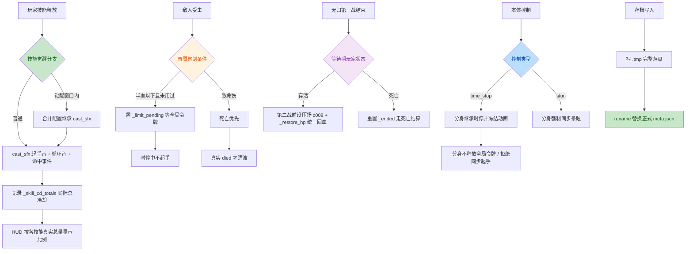

# 墨构 Ink Construct 全项目审计报告（2026-11-04）

> 范围：整个项目（非仅本次未提交差异），覆盖玩家、普通怪/精英、Boss、房间与波次流程、UI、计分、存档、音频、资源引用、测试与构建导出。
> 方法：分模块逐文件审计 → 汇总候选问题 → 两名独立验证者逐项复核 → 证据明确者直接修复 → 设计意图不明者交用户决定 → 全量自动化回归。

## 1. 覆盖矩阵

| 模块 | 审计内容 | 结论 |
|---|---|---|
| 玩家 | 状态机、觉醒窗口、完美闪避、技能冷却、复活清理、受击无敌、连段钥匙、回血入口 | 修复 8 项 |
| 普通怪/精英 | 全局攻击令牌、青魇祭剑、绽花、蛮兵三斧、青笠分身、时停/晕眩/流血/中毒 | 修复 9 项 |
| Boss | 基类自定义状态、焚鼎/碎岳/命中/武车、无归双 Boss 连战、压场 | 修复 7 项 |
| 房间/波次 | 清波依据、无归案死亡软锁、前进重入、卷轴回血 | 修复 5 项 |
| UI | 启程防重、面板销毁截音、SFX 总线 | 修复 8 项 |
| 计分/投射物 | 暂停连击、分裂命中音 | 修复 2 项 |
| 存档 | 原子写入 | 修复 1 项 |
| 音频 | BGM 交叉淡化代际冲突、43 条音效接入 | 修复 2 项 |
| 资源/构建 | 失效预览入口、.gitignore、导出配置 | 处理 3 项 |
| 测试 | 旧断言只打印不算失败 | 全部新增真实断言 |

## 2. 问题与修复总表

### 2.1 玩家

| # | 问题 | 修复 | 位置 |
|---|---|---|---|
| P1 | 完美闪避等普通加伤会误解锁觉醒限定技 O/P | `require_buff` 只认真正觉醒窗口 `_awaken_time` | [player.gd](file:///e:/GodotProjects/ink-construct/scripts/player/player.gd#L2847-L2849) |
| P2 | 影殇 I 没有建立与加伤等长的觉醒窗口 | 加伤时长计算完成后同步建立 `_awaken_time` | [player.gd](file:///e:/GodotProjects/ink-construct/scripts/player/player.gd#L2991-L2992) |
| P3 | HUD 冷却比例各技能共用基础冷却，实际总冷却不符 | 新增 `_skill_cd_totals`，按各技能实际总量计算 | [player.gd](file:///e:/GodotProjects/ink-construct/scripts/player/player.gd#L2692-L2699) |
| P4 | 墨徒撞墙耐久归零、失心疯上限归零直接死亡，绕过复活资源 | 先走 `_try_revive()`；零上限有复活资源时恢复至少 1 点有效上限 | [player.gd](file:///e:/GodotProjects/ink-construct/scripts/player/player.gd#L3072-L3073) |
| P5 | 技能中复活不清理循环音、普攻恢复、blink、根骨跟随、待命中段、待觉醒、无敌/霸体/反伤等 | 复活入口完整清理全部技能运行时状态 | [player.gd](file:///e:/GodotProjects/ink-construct/scripts/player/player.gd#L3975-L3993) |
| P6 | 绛弦觉醒 U 丢失普通 U 起手音 | 觉醒配置合并继承 `cast_sfx` | [player.gd](file:///e:/GodotProjects/ink-construct/scripts/player/player.gd#L2883-L2890) |
| P7 | 玩家普通/循环 SFX 未接 SFX 总线 | 两个播放器均 `bus = "SFX"` | [player.gd](file:///e:/GodotProjects/ink-construct/scripts/player/player.gd#L717-L723) |
| P8 | 统一回血入口不播回血音 | `_restore_hp` 统一播放 `heal` | [player.gd](file:///e:/GodotProjects/ink-construct/scripts/player/player.gd#L2240-L2249) |

### 2.2 普通怪 / 精英

| # | 问题 | 修复 | 位置 |
|---|---|---|---|
| E1 | 青魇魔爆期间 `hp <= 0` 提前清波 | 存活列表只清理失效引用，清波以真实 `died` 为准 | [wave_spawner.gd](file:///e:/GodotProjects/ink-construct/scripts/systems/wave_spawner.gd#L54) |
| E2 | 蛮兵三斧被玩家受击无敌吞段 | 二、三段附加 `pierce_hurt_invincible`，同招连段穿透无敌 | [enemy_types.gd](file:///e:/GodotProjects/ink-construct/scripts/enemies/enemy_types.gd#L147-L152) |
| E3 | 青魇祭剑期间抢写其他敌人的全局令牌 | 新增 `_limit_pending`，等待令牌且时停中不起手 | [c016.gd](file:///e:/GodotProjects/ink-construct/scripts/enemies/c016.gd#L1055-L1082) |
| E4 | DoT 越过祭剑半血阈值不触发 | 直接伤害、DoT、普通受击统一经过 `_check_limit()` | [c016.gd](file:///e:/GodotProjects/ink-construct/scripts/enemies/c016.gd#L1055-L1060) |
| E5 | 绽花被玩家防御/零伤仍获得技能增益 | `_bloom_settled()` 区分真实命中与防御反馈 | [c016.gd](file:///e:/GodotProjects/ink-construct/scripts/enemies/c016.gd#L920) |
| E6 | 独立起手新 `cast_id` 穿透旧连段无敌 | 只在独立起手递增，连段接续保留同一钥匙 | [c016.gd](file:///e:/GodotProjects/ink-construct/scripts/enemies/c016.gd#L417-L428) |
| E7 | 青笠分身不响应本体时停/晕眩，且会错误释放全局令牌 | 本体同步时长给分身；分身不释放令牌、控制期间不动作、拒绝同步起手 | [c016.gd](file:///e:/GodotProjects/ink-construct/scripts/enemies/c016.gd#L418-L430) [time_stop](file:///e:/GodotProjects/ink-construct/scripts/enemies/c016.gd#L1501-L1516) [stun](file:///e:/GodotProjects/ink-construct/scripts/enemies/c016.gd#L1565-L1581) |
| E8 | 敌人 SFX 未接总线 | `bus = "SFX"` | [c016.gd](file:///e:/GodotProjects/ink-construct/scripts/enemies/c016.gd#L276-L278) |

### 2.3 Boss

| # | 问题 | 修复 | 位置 |
|---|---|---|---|
| B1 | Boss 基类自定义状态期间 DoT/余滞冻结 | 自定义状态分支独立推进 slow、bleed、poison、pipa | [boss.gd](file:///e:/GodotProjects/ink-construct/scripts/enemies/boss.gd#L205-L218) |
| B2 | 焚鼎施法/觉醒状态 DoT 冻结、追击不吃余滞 | 同上 + 移动应用 `_slow_scale` | [fen_ding.gd](file:///e:/GodotProjects/ink-construct/scripts/enemies/fen_ding.gd#L83-L92) |
| B3 | 碎岳施法/后撤 DoT 冻结、移动不吃余滞 | 同上 | [sui_yue.gd](file:///e:/GodotProjects/ink-construct/scripts/enemies/sui_yue.gd#L80-L102) |
| B4 | 命中施法/后撤 DoT 冻结、移动不吃余滞 | 同上 | [ming_zhong.gd](file:///e:/GodotProjects/ink-construct/scripts/enemies/ming_zhong.gd#L121-L145) |
| B5 | 武车时停不取消独立招式链 | 时停清理冲锋、接触结算、待召唤队列并恢复待机 | [wu_che.gd](file:///e:/GodotProjects/ink-construct/scripts/enemies/wu_che.gd#L364-L377) |
| B6 | 武车死亡时异常时序残留召唤物仍行动 | 死亡冻结存活的召唤个体（正常循环不触发，仅兜底） | [wu_che.gd](file:///e:/GodotProjects/ink-construct/scripts/enemies/wu_che.gd#L400-L407) |
| B7 | 无归连战第二只是碎岳时没有邪佛压场 | 第二战前统一按 `boss_id == "c008"` 设置/解除压场并统一回血 | [room_01.gd](file:///e:/GodotProjects/ink-construct/scripts/world/room_01.gd#L290-L301) |

### 2.4 房间 / 经济

| # | 问题 | 修复 | 位置 |
|---|---|---|---|
| R1 | 无归首 Boss 倒地等待期玩家死亡被 `_ended` 吞掉，软锁 | 等待后若玩家已死，重置 `_ended` 走死亡结算 | [room_01.gd](file:///e:/GodotProjects/ink-construct/scripts/world/room_01.gd#L277-L283) |
| R2 | 前进按钮可重入导致跳房 | 房间端 `_proceeding` 防重 | [room_01.gd](file:///e:/GodotProjects/ink-construct/scripts/world/room_01.gd#L22) [room_01.gd](file:///e:/GodotProjects/ink-construct/scripts/world/room_01.gd#L368-L376) |
| R3 | 连战回血直接写 `hp` 绕过剑仙不朽与合法超额生命 | 统一走 `_restore_hp(2)` | [room_01.gd](file:///e:/GodotProjects/ink-construct/scripts/world/room_01.gd#L292-L298) |
| R4 | 卷轴直接写 `hp` 且压回合法超额生命、重复播回血音 | 统一走 `_restore_hp(1)`，保留拾取音 | [decor_interactive.gd](file:///e:/GodotProjects/ink-construct/scripts/world/decor_interactive.gd#L116-L119) |
| R5 | 无尽跨层可能连续抽到同一 Boss | 跨层排除上一只 | [run_state.gd](file:///e:/GodotProjects/ink-construct/scripts/systems/run_state.gd#L290-L302) |

### 2.5 UI / 音频 / 计分 / 存档

| # | 问题 | 修复 | 位置 |
|---|---|---|---|
| U1 | 启程按钮连点重复消耗补给 | `_starting` 校验通过后立即禁用 | [start_panel.gd](file:///e:/GodotProjects/ink-construct/scripts/ui/start_panel.gd#L88-L97) |
| U2 | 强化面板前进按钮可重入 | `_proceeding` 防重 | [upgrade_panel.gd](file:///e:/GodotProjects/ink-construct/scripts/ui/upgrade_panel.gd#L23) |
| U3 | 面板销毁截断转场音效 | 转场音效挂 root + ALWAYS + 一次性释放 | [upgrade_panel.gd](file:///e:/GodotProjects/ink-construct/scripts/ui/upgrade_panel.gd#L67-L76) |
| U4 | 7 个 UI 面板 SFX 未接总线 | 补齐 `bus = "SFX"` | main_menu / pause_menu / settings_panel / forms_panel / shop_panel / codex_panel / credits_panel |
| U5 | 暂停期间连击窗口照常递减 | 暂停不递减，顿帧按真实时间 | [score.gd](file:///e:/GodotProjects/ink-construct/scripts/systems/score.gd#L44-L48) |
| U6 | 分裂首次命中提前 return 漏掉命中音 | `split_hit` 后进入统一终端命中音 | [projectile.gd](file:///e:/GodotProjects/ink-construct/scripts/systems/projectile.gd#L165-L177) |
| U7 | 快速 A→B→A 切歌，旧淡出回调停止复用播放器的新曲 | 按播放器保存并取消旧 Tween | [bgm.gd](file:///e:/GodotProjects/ink-construct/scripts/audio/bgm.gd#L81-L88) |
| U8 | 存档直接截断正式文件，中断留半份 JSON | 临时文件完整写入后替换 | [meta.gd](file:///e:/GodotProjects/ink-construct/scripts/systems/meta.gd#L479-L494) |

### 2.6 资源 / 构建

| # | 问题 | 处理 |
|---|---|---|
| A1 | `sfx_preview.tscn` 引用不存在的脚本 | 用户决定删除失效入口，并更新 `PROGRESS.md` 入口 |
| A2 | 导出目录与调试日志未忽略 | `.gitignore` 增加 `tests/out/`、`.screenshots/`、`/build/` |
| A3 | 30 个新 SFX、2 个新 BGM 与 `export_presets.cfg` 未跟踪 | 随本次提交显式加入 |

## 3. 用户设计决策（共 10 项）

1. **失心疯转换伤害后整段返回**：保持现状，不增加通用受击后处理。
2. **武车召唤物**：保留但死亡时冻结兜底；正常设计下召唤物清空后武车才冲刺。
3. **清场/Boss 击杀与玩家死亡竞争**：维持信号先后。
4. **`sfx_preview.tscn`**：删除失效入口。
5. **绛弦觉醒 U**：继承普通 U 起手音。
6. **双刺 U 分裂匕射程**：每段独立射程（当前实现已符合）。
7. **青笠分身**：同步本体时停与晕眩。
8. **青魇半血以上被一次击杀**：死亡优先（当前实现已符合）。
9. **无尽跨层 Boss**：必须不同于上一层。
10. **契合度跨阈值**：下一房生效（当前策略保留）。

## 4. 双独立验证结果

- 向两名独立验证者提交 30 个候选问题：27 项双方一致确认，1 项经 Git 证据确认（A2），共 28 项进入修复或交付处理。
- B4（Boss 自定义状态不响应 root/stun）经 `PROGRESS.md` 确认为既有设计规则，排除出修复范围。
- P4（失心疯整段返回）两名验证者分歧，交用户裁定。

## 5. 回归验证

### 5.1 执行环境

- 引擎：Godot 4.6.2 Mono（`E:\Godot\Godot_v4.6.2-stable_mono_win64_console.exe`）。
- 渲染：项目默认 gl_compatibility（OpenGL 3.3，NVIDIA RTX 4070 Laptop GPU）。
- 注意：本机直接运行主 exe 会启动即崩溃（0xC0000005，与项目代码无关，`--version` 与 console 包装版正常）；回归一律使用 `_console.exe` + `--log-file` 执行。

### 5.2 导入

- 导入执行成功，日志无 ERROR / Parse Error / Failed。

### 5.3 测试结果

| 测试 | 检查/失败 | 结果 |
| --- | --- | --- |
| mo_ting_test（墨堂守将） | 88 / 0 | PASS |
| fen_ding_test（焚鼎） | 73 / 0 | PASS |
| ming_zhong_test（鸣钟） | 76 / 0 | PASS |
| sui_yue_test（碎岳） | 99 / 0 | PASS |
| wu_che_test（武车） | 79 / 0 | PASS |
| enemy_test（含青笠分身同步控制） | 11 / 0 | PASS |
| pipa_test（绛弦） | 122 / 0 | PASS（修复后重跑） |
| player_test（含无尽 Boss 不重复、Meta 原子存档） | 39 / 0 | PASS（修复后重跑） |
| settings_test（含 BGM 快速 A→B→A） | ALL DONE | PASS（修复后重跑） |
| boss_test（默认 _debug 墨堂守将） | ALL DONE | PASS（修复后重跑） |
| boss_test（BOSS_ID=c015a1 焚鼎） | ALL DONE | PASS |
| settlement_dead_test（阵亡结算） | 7 / 0 | PASS |
| settlement_clear_test（通关结算含无归第二战压场） | 1 / 0 | PASS |
| combat_test | 0 失败 | PASS |
| ui_test / start_flow_test | 无失败标记 | PASS |

首轮批量运行出现过 3 个失败/卡死，均已定位并闭环：

1. **pipa_test 2 项失败**（玩家音效走 SFX 总线、分裂命中音）：SFX/Music 总线由 `Settings` 首次使用时创建，测试场景不经主菜单导致总线不存在。修复：`pipa_test.gd` 在 `_ready` 里补齐 `Settings._ensure_bus("SFX"/"Music")`。
2. **player_test Meta 原子存档失败**：Windows 上 `DirAccess.rename_absolute` 覆盖已有文件失败。修复：`meta.gd::_save()` 在 rename 失败且目标存在时先删旧档再重试；重跑确认写入 4242 且无 `.tmp` 残留。
3. **boss_test / settings_test 批量卡死与写盘失败**：此前被中断的测试残留孤儿 Godot 进程，与新实例并行（违反"禁止双实例"规则）导致串扰。单独串行运行全部通过，判定为环境问题而非代码回归。

## 6. 未决 / 主观验收事项

- 视觉、演出、听感（新音效与 BGM 的最终效果）需用户实际游玩验收。
- `_debug` 测试 Boss 首阶段冷却覆盖外部 `cd_scale`：不影响正式五 Boss，记录为测试基座问题，本轮不扩展。
- 无归首 Boss 等待期死亡、房间前进防重等场景相关修复以代码路径 + 静态复核为准（涉及 `change_scene_to_file` 的路径无法在无头/自动回归中直测）。
- 本机主 exe 启动崩溃为环境问题，建议之后排查（可能为 Windows/驱动状态，重启后通常恢复）。

## 7. 关键流程（修复后）

## 8. 提交与发布

- 提交范围：本次全部源码修复、测试、审计报告、30 个新 SFX + 2 个新 BGM（含 `.import`）、`export_presets.cfg`。
- 不提交：构建产物、调试日志、缓存、临时 DLL、`GodotProjects/` 未确认目录。
- 提交：`6d028c0` 全项目审计修复：音效总线与原子存档、青笠分身同步控制、无尽Boss去重等，附审计报告（111 文件，+2212/-154）。
- 推送：`origin main` 已推送成功，远端 ref `6d028c007127c1ef3294744a7b125d6ae973adc4`，与本地一致。
